# Abastece

[](https://github.com/FelipePacheco30/abastece/actions/workflows/ci.yml)

Atividade Substitutiva da Prova 1 · Programação para Dispositivos Móveis I · Prof. Arley · Fatec

Aplicativo Flutter para controlar os gastos com combustível de um veículo. O usuário cadastra
o carro com marca e modelo da tabela FIPE (consultados na [BrasilAPI](https://brasilapi.com.br)),
registra cada abastecimento e acompanha em um painel o valor gasto, o consumo em km/L e o
custo por quilômetro rodado. Tudo fica salvo no próprio aparelho.

## Integrante

- Felipe Ferreira Pacheco

## Sumário

- [Funcionalidades](#funcionalidades)
- [Capturas de tela](#capturas-de-tela)
- [Como executar](#como-executar)
- [API utilizada](#api-utilizada)
- [Bibliotecas adotadas](#bibliotecas-adotadas)
- [Cálculo dos indicadores](#cálculo-dos-indicadores)
- [Persistência local](#persistência-local)
- [Estrutura do projeto](#estrutura-do-projeto)
- [Testes](#testes)
- [Decisões de projeto](#decisões-de-projeto)
- [Processo de desenvolvimento](#processo-de-desenvolvimento)

## Funcionalidades

| Requisito da atividade | Como foi atendido |
| --- | --- |
| Cadastro de um veículo por vez | Marca, modelo, ano e cilindrada. Enquanto há um veículo, não é possível cadastrar outro. |
| Marca e modelo pela API | Listas pesquisáveis da tabela FIPE na BrasilAPI. Os modelos são os da marca escolhida, e trocar a marca limpa o modelo. |
| Excluir o veículo | Pede confirmação, informando quantos abastecimentos serão apagados junto com ele. Depois disso, o app volta à tela de cadastro. |
| Registro de abastecimentos | Combustível (etanol, gasolina ou diesel), preço por litro, quilometragem, litros, data e horário. |
| Valor total | Preço por litro × litros, calculado enquanto o usuário digita e exibido em cada registro. |
| Persistência local | Veículo e abastecimentos ficam no `SharedPreferences` do aparelho e continuam lá depois de fechar o app ([detalhes](#persistência-local)). |
| Dashboard | Gasto total, distância, consumo médio e custo médio por km, mais três gráficos: valor de cada abastecimento, km/L e R$/km. |
| Indicadores a partir do 2º abastecimento | O primeiro registro serve de referência e aparece como tal. Os seguintes mostram distância, km/L e R$/km ([fórmulas](#cálculo-dos-indicadores)). |
| Biblioteca de gráficos | [fl_chart](https://pub.dev/packages/fl_chart): barras por combustível e linhas de evolução com a média do período. |
| Navegação | Boas-vindas → cadastro → telas do veículo em três abas (Painel, Abastecimentos, Veículo), com `Navigator` para formulários e seleções. |

Além do que foi pedido:

- **Edição e exclusão de abastecimentos**, com recálculo dos indicadores.
- **Validação da quilometragem**: ela precisa ficar entre a do abastecimento anterior e a do
  seguinte na data escolhida. Isso evita distâncias negativas ou nulas nos indicadores.
- **Cilindrada sugerida** a partir do nome do modelo da FIPE (`ARGO DRIVE 1.3 8V Flex` → 1,3 L).
- **Tema claro e escuro** seguindo o sistema.
- **Fonte ampliada**: as telas foram testadas com o texto do sistema em até 200%.

## Capturas de tela

As imagens são das telas reais do app, renderizadas com respostas da BrasilAPI gravadas
([como são geradas](#capturas-de-tela-1)). O histórico de exemplo tem três meses de
abastecimentos de um Fiat Argo 1.3, alternando gasolina e etanol.

### Cadastro do veículo

| 1. Boas-vindas | 2. Marca | 3. Modelo | 4. Cadastro |
| :---: | :---: | :---: | :---: |
| 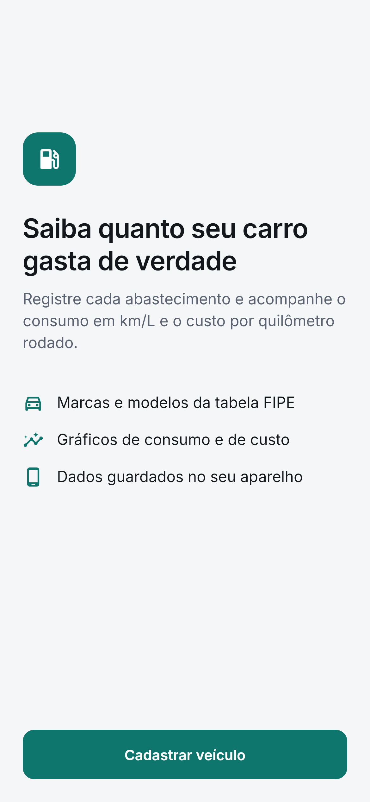 | 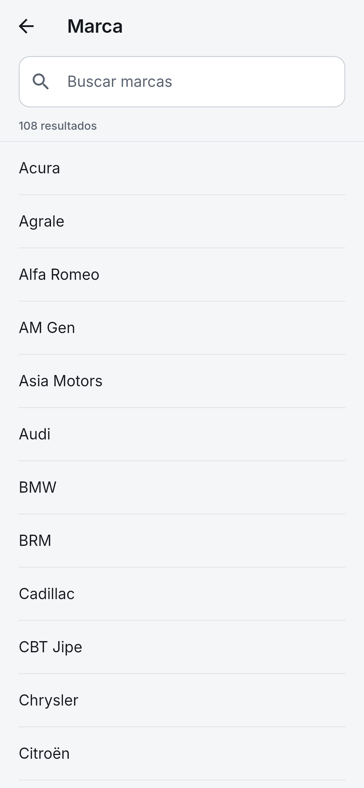 | 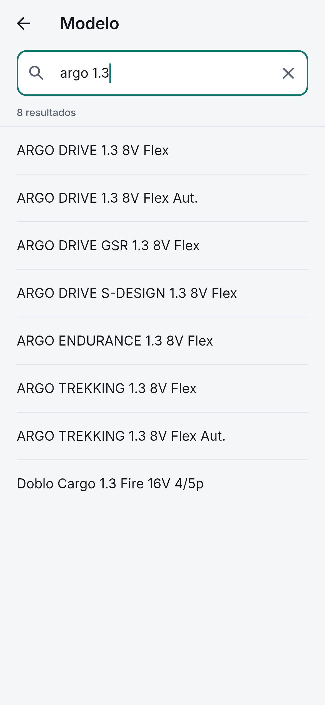 | 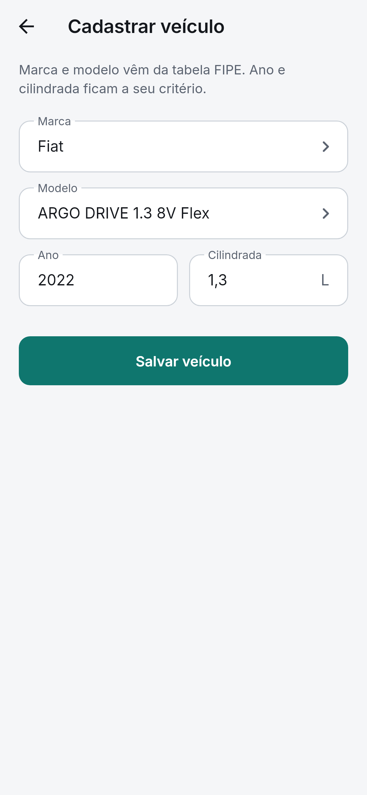 |
| O que o app faz e a ação de cadastrar. | 108 marcas da tabela FIPE, com busca. | Modelos da marca escolhida; a busca ignora acentos e aceita várias palavras. | A cilindrada veio do nome do modelo. |

### Painel

| 5. Indicadores | 6. Consumo e custo | 7. Primeiro abastecimento |
| :---: | :---: | :---: |
| 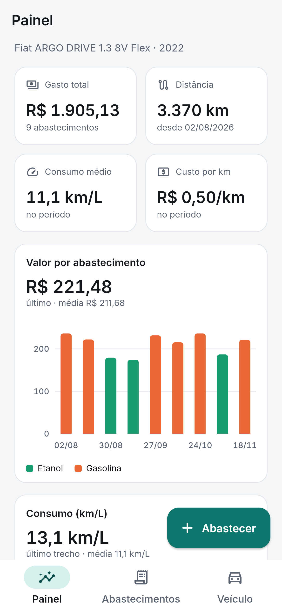 | 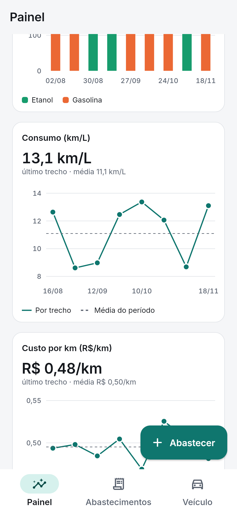 | 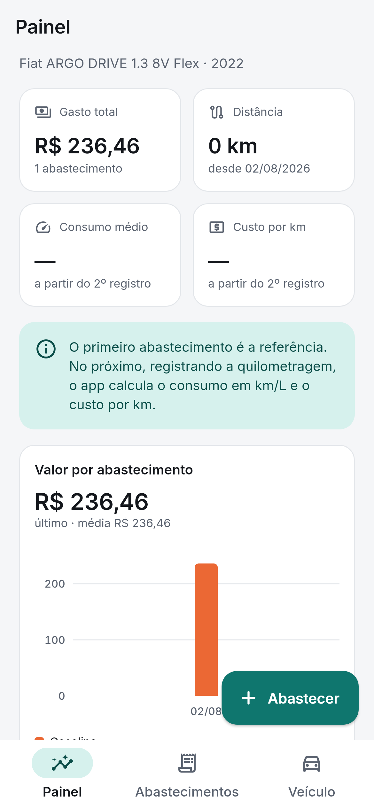 |
| Totais do período e valor de cada abastecimento, colorido por combustível. | Evolução de km/L e R$/km por trecho, com a média tracejada. | O primeiro registro é a referência; o painel explica quando os indicadores aparecem. |

### Abastecimentos

| 8. Histórico | 9. Novo abastecimento | 10. Validação | 11. Edição |
| :---: | :---: | :---: | :---: |
| 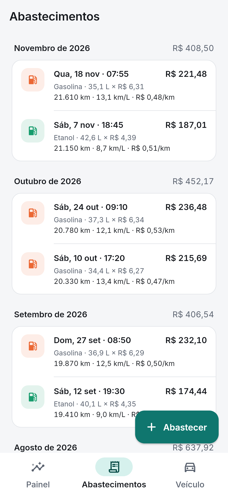 | 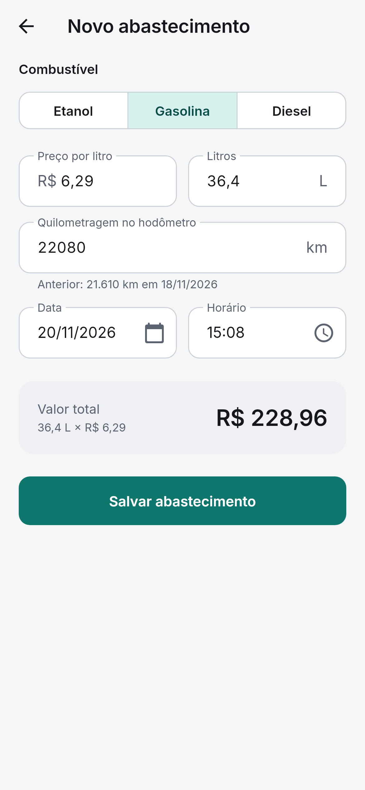 | 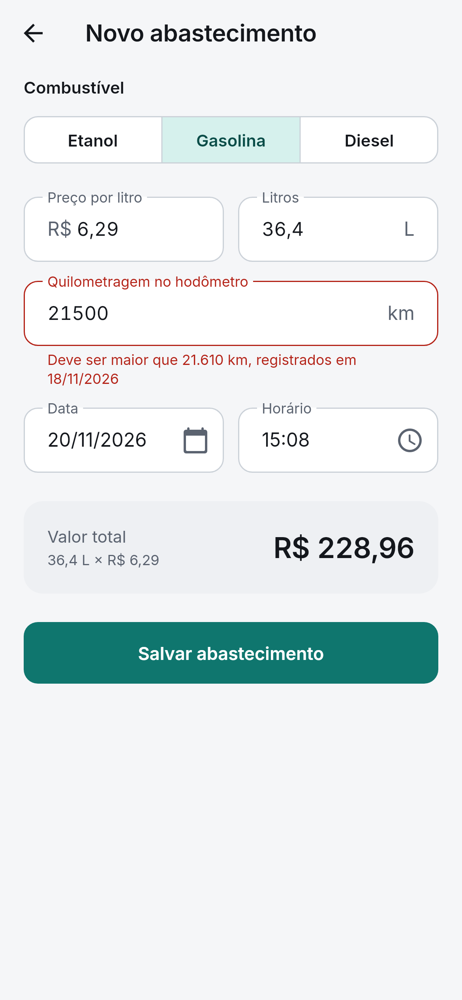 | 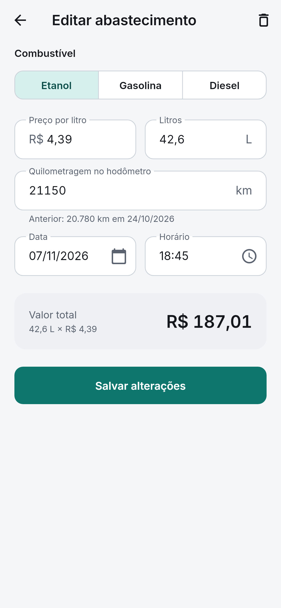 |
| Agrupado por mês, com o total do mês e os indicadores de cada trecho. | Valor total calculado enquanto o usuário digita. | Quilometragem menor que a do registro anterior. | O mesmo formulário edita e exclui. |

### Veículo e estados

| 12. Veículo | 13. Exclusão | 14. Sem conexão |
| :---: | :---: | :---: |
| 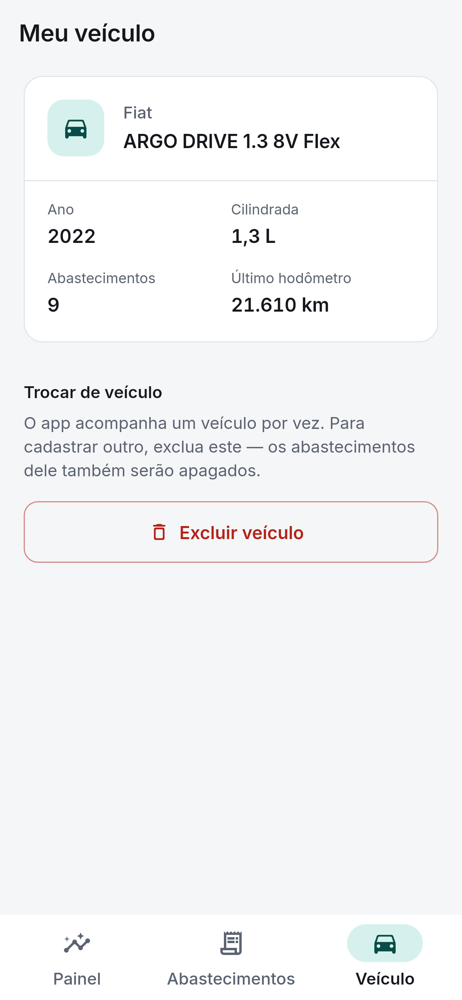 | 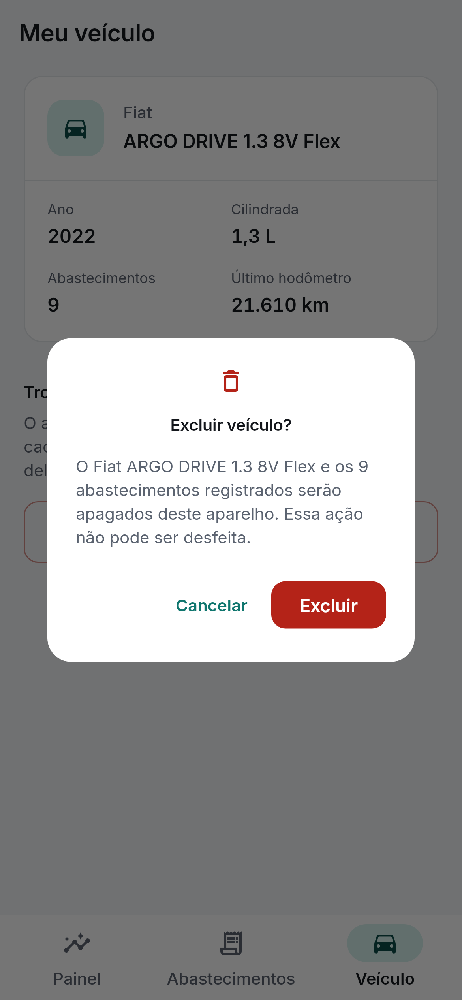 |  |
| Dados do veículo e a opção de trocá-lo. | A confirmação informa quantos abastecimentos serão apagados. | Falha da BrasilAPI com a opção de tentar novamente. |

### Tema escuro

| 15. Painel | 16. Gráficos | 17. Abastecimentos |
| :---: | :---: | :---: |
| 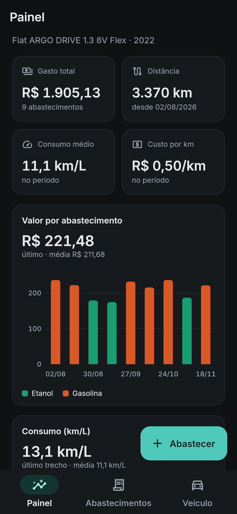 | 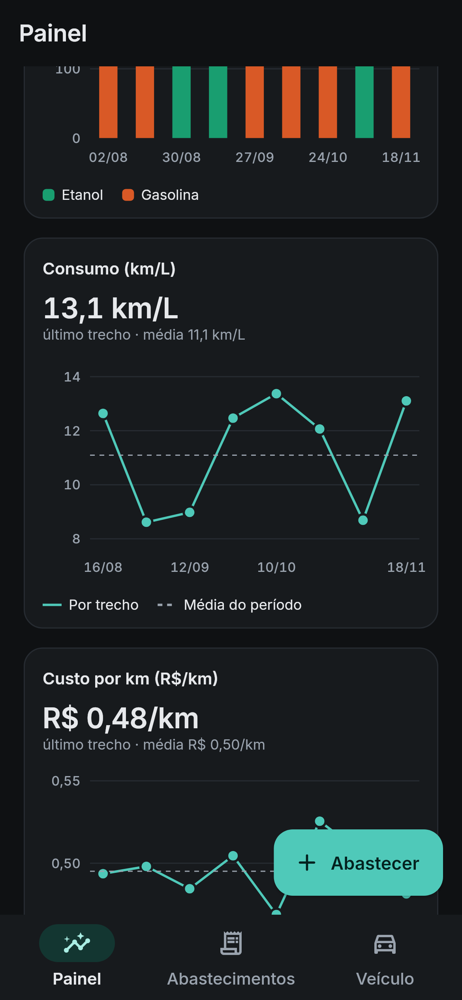 | 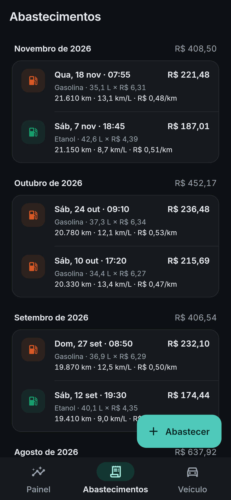 |

## Como executar

Pré-requisitos: [Flutter](https://docs.flutter.dev/get-started/install) 3.47 ou superior
(Dart 3.13) e um emulador ou aparelho Android/iOS. O app precisa de internet só no cadastro
do veículo, para consultar marcas e modelos.

```bash
git clone https://github.com/FelipePacheco30/abastece.git
cd abastece
flutter pub get
flutter run
```

Para gerar o APK de release:

```bash
flutter build apk --release
```

O APK também é gerado pelo GitHub Actions a cada push na `main` (artefato `abastece-apk` na
[aba Actions](https://github.com/FelipePacheco30/abastece/actions)) e está anexado à
[versão 1.0.0](https://github.com/FelipePacheco30/abastece/releases/tag/v1.0.0).

### Verificação

```bash
dart format --set-exit-if-changed lib test tool
flutter analyze
flutter test
```

Os mesmos comandos rodam no GitHub Actions em todo push e pull request, junto com o build do
APK ([.github/workflows/ci.yml](.github/workflows/ci.yml)).

### Capturas de tela

```bash
flutter test tool/capturas --update-goldens
```

O gerador ([tool/capturas/capturas_test.dart](tool/capturas/capturas_test.dart)) monta o app
real em tamanho de celular (390×844, densidade 3x) com as fontes Inter e Material Icons,
percorre cada fluxo com a BrasilAPI simulada pelas respostas de `test/fixtures` e grava as
imagens em `docs/capturas`. Ele fica fora de `test/` porque a renderização de fontes muda
entre sistemas, e um teste de imagem falharia na CI sem que o app tivesse mudado. O ícone
do app é gerado da mesma forma por `flutter test tool/icone --update-goldens`.

## API utilizada

[BrasilAPI](https://brasilapi.com.br/docs#tag/FIPE), endpoints da tabela FIPE para carros:

| Consulta | Endereço | Campos usados |
| --- | --- | --- |
| Marcas | `GET https://brasilapi.com.br/api/fipe/marcas/v1/carros` | `nome`, `valor` (código da marca) |
| Modelos da marca | `GET https://brasilapi.com.br/api/fipe/veiculos/v1/carros/{codigoMarca}` | `modelo` |

```json
[{ "nome": "Fiat", "valor": "21" }, { "nome": "Ford", "valor": "22" }]
[{ "modelo": "ARGO DRIVE 1.3 8V Flex", "valor": "7966" }]
```

Comportamentos tratados pelo [cliente](lib/data/cliente_brasil_api.dart):

- **Falhas tipadas**: sem conexão ou tempo esgotado (15 s), serviço indisponível (qualquer
  status diferente de 200; um código de marca inexistente, por exemplo, responde `500`) e
  resposta fora do formato. Cada uma tem mensagem própria e a tela oferece nova tentativa.
- **Cache em memória**: marcas e modelos já obtidos não são consultados de novo durante a
  sessão. Falhas não ficam em cache.
- **Só carros**: o app usa `carros`, que na FIPE inclui picapes e utilitários a diesel.
  Motos e caminhões ficaram de fora porque a cilindrada de motos é informada em cm³, e
  tratar as duas unidades complicaria o cadastro sem ganho para a atividade.

## Bibliotecas adotadas

| Biblioteca | Versão | Uso |
| --- | --- | --- |
| [fl_chart](https://pub.dev/packages/fl_chart) | 1.3.1 | Gráficos de barras e de linhas do painel. |
| [http](https://pub.dev/packages/http) | 1.6.0 | Requisições à BrasilAPI; `MockClient` nos testes. |
| [shared_preferences](https://pub.dev/packages/shared_preferences) | 2.5.6 | Persistência local (API `SharedPreferencesWithCache`). |
| [intl](https://pub.dev/packages/intl) | 0.20.3 | Moeda, números e datas em pt-BR. |
| flutter_localizations | SDK | Textos dos componentes do Material (calendário, relógio) em pt-BR. |
| [flutter_lints](https://pub.dev/packages/flutter_lints) | 6.0.0 | Regras de análise estática (dev). |
| [shared_preferences_platform_interface](https://pub.dev/packages/shared_preferences_platform_interface) | 2.4.2 | Armazenamento em memória nos testes (dev). |

A fonte [Inter](https://rsms.me/inter/) (licença [OFL](assets/fonts/OFL.txt)) vai embutida no
app, nos pesos 400, 500 e 600. Por isso não há download em tempo de execução.

## Cálculo dos indicadores

Como pede o enunciado, todo registro é tratado como tanque cheio. Os abastecimentos são
ordenados por data e horário, e, a partir do segundo:

| Indicador | Fórmula |
| --- | --- |
| Valor total | preço por litro × litros |
| Distância percorrida | quilometragem atual − quilometragem do abastecimento anterior |
| Consumo (km/L) | distância ÷ litros do abastecimento atual |
| Custo (R$/km) | valor total do abastecimento atual ÷ distância |

Exemplo com dois registros: 10.000 km e depois 10.500 km com 40 L a R$ 6,00 → valor de
R$ 240,00, distância de 500 km, consumo de 12,5 km/L e custo de R$ 0,48/km.

Os indicadores gerais do painel são **médias ponderadas pela distância**: o consumo médio é
o total rodado dividido pelos litros que repuseram esse trajeto, e o custo médio é o valor
desses abastecimentos dividido pelo total rodado. A média simples das razões daria o mesmo
peso a um trecho de 50 km e a um de 600 km. O primeiro abastecimento entra no gasto total,
mas não nas médias, porque não há trecho rodado antes dele.

A lógica fica em [`Historico`](lib/models/historico.dart), em Dart puro e coberta por testes
de unidade.

## Persistência local

Os dados ficam no `SharedPreferences` do aparelho, acessado pela API
`SharedPreferencesWithCache`. As leituras vêm de um cache carregado na abertura do app, e
as gravações são assíncronas. Toda a leitura e escrita passa por
[`ArmazenamentoLocal`](lib/data/armazenamento_local.dart):

| Chave | Conteúdo |
| --- | --- |
| `veiculo` | Objeto JSON com `marca`, `modelo`, `ano` e `cilindrada`. |
| `abastecimentos` | Lista JSON em ordem cronológica. |

```json
{
  "id": "1763673300000000",
  "combustivel": "etanol",
  "precoPorLitro": 4.39,
  "litros": 42.6,
  "quilometragem": 21150,
  "data": "2026-11-07T18:45:00.000"
}
```

- **Gravar antes de exibir**: o [`ControladorGaragem`](lib/controllers/controlador_garagem.dart)
  só atualiza a tela depois que a gravação termina. Se ela falhar, o formulário avisa e
  continua editável.
- **Exclusão do veículo**: os abastecimentos são removidos antes do veículo, para que uma
  interrupção nunca deixe registros órfãos. Abastecimentos sem veículo válido também não
  são carregados.
- **Dados corrompidos**: um registro ilegível é descartado sozinho, sem perder os demais nem
  impedir a abertura do app.

O `SharedPreferences` foi escolhido em vez de SQLite porque há um único veículo e uma lista
pequena, sempre lida inteira para calcular os indicadores, sem consultas. Um banco relacional
acrescentaria tabelas, migrações e uma dependência nativa sem ganho para esse volume.

## Estrutura do projeto

```
lib/
├── main.dart                          datas em pt-BR, abertura do armazenamento e dependências
├── app.dart                           MaterialApp: temas, localização e tela inicial
├── core/
│   ├── formatos.dart                  moeda, litros, km, km/L, R$/km, datas e entrada decimal
│   └── tema.dart                      cores, tipografia, componentes e cores dos combustíveis
├── models/
│   ├── veiculo.dart                   veículo e cilindrada a partir do nome do modelo
│   ├── abastecimento.dart             abastecimento, combustível e valor total
│   ├── historico.dart                 trechos, km/L, R$/km, médias e vizinhos de uma data
│   └── opcao_fipe.dart                marca ou modelo da FIPE
├── data/
│   ├── cliente_brasil_api.dart        requisições, tempo limite, cache e conversão de erros
│   ├── falhas.dart                    falhas tipadas com mensagens para o usuário
│   └── armazenamento_local.dart       SharedPreferences: veículo e abastecimentos
├── controllers/
│   └── controlador_garagem.dart       estado compartilhado do veículo e dos abastecimentos
└── presentation/
    ├── screens/
    │   ├── tela_boas_vindas.dart      sem veículo cadastrado
    │   ├── tela_cadastro_veiculo.dart formulário do veículo
    │   ├── tela_selecao_fipe.dart     lista pesquisável de marcas ou modelos
    │   ├── tela_principal.dart        abas Painel, Abastecimentos e Veículo
    │   ├── aba_painel.dart            indicadores gerais e gráficos
    │   ├── aba_abastecimentos.dart    histórico agrupado por mês
    │   ├── aba_veiculo.dart           dados e exclusão do veículo
    │   └── tela_abastecimento.dart    registro, edição e exclusão de abastecimento
    └── widgets/
        ├── graficos.dart              gráficos de valores e de evolução e suas legendas
        ├── campo_selecao.dart         campo que abre uma seleção
        ├── confirmacao.dart           diálogo de confirmação de exclusão
        ├── aviso.dart                 avisos no rodapé
        ├── icone_combustivel.dart     marcador na cor do combustível
        └── mensagem_estado.dart       estados vazios e de erro

test/                                  unidade (models, data, controllers, core) e widget (presentation)
tool/capturas/                         gerador das capturas de tela
tool/icone/                            gerador do ícone do app
docs/capturas/                         imagens usadas neste README
```

As dependências apontam sempre para dentro: telas usam o controlador, o controlador usa o
armazenamento, e os modelos não dependem de nada. Modelos e a camada `data` não importam
Flutter (com exceção do `shared_preferences`).

## Testes

```bash
flutter test
```

66 testes, todos sem acesso à rede: a BrasilAPI é simulada com `MockClient` e respostas
reais gravadas em [test/fixtures](test/fixtures).

| Arquivo | O que verifica |
| --- | --- |
| `models/historico_test.dart` | Primeiro registro como referência, km/L e R$/km, ordenação, médias ponderadas e vizinhos de uma data. |
| `models/veiculo_test.dart`, `abastecimento_test.dart` | JSON, valor total, ordenação e cilindrada extraída de nomes reais da FIPE. |
| `data/cliente_brasil_api_test.dart` | Endereços, marcas e modelos reais, cache, falta de conexão, tempo esgotado, 500, 429 e respostas inválidas. |
| `data/armazenamento_local_test.dart` | Gravação e leitura, exclusão em cascata e dados corrompidos. |
| `controllers/controlador_garagem_test.dart` | Carga, substituição por `id`, ordem, notificações e abastecimentos órfãos. |
| `core/formatos_test.dart` | Moeda, litros, km, datas e a entrada decimal com vírgula. |
| `presentation/cadastro_veiculo_test.dart` | Cadastro completo e persistência, validações, troca de marca, falha da API, busca e exclusão com confirmação. |
| `presentation/abastecimentos_test.dart` | Registro, indicadores no segundo abastecimento, campos obrigatórios, quilometragem inválida, edição e exclusão. |
| `presentation/painel_test.dart` | Painel vazio, com um registro e com o histórico completo. |
| `presentation/fonte_ampliada_test.dart` | Todas as abas e o formulário em 320 dp com fonte em 150% e 200%, sem estouro de layout. |

## Decisões de projeto

- **Interface sóbria**: fundo neutro, cartões com borda fina em vez de sombra e uma única cor
  de destaque. Cores com significado aparecem só onde importam (combustível nos gráficos e na
  lista). Sem gradientes, transparências ou animações além das transições padrão.
- **Cores acessíveis**: as cores dos combustíveis (verde-água, laranja e azul) foram
  validadas para daltonismo e contraste nos dois temas. O nome do combustível sempre
  acompanha a cor, que nunca é a única pista. As linhas de km/L e R$/km usam a cor primária,
  para não sugerir relação com um combustível.
- **Um gráfico por medida**: km/L e R$/km têm escalas diferentes. Em vez de um gráfico com
  dois eixos, que confunde a leitura, cada medida tem o seu.
- **Sem pacote de gerência de estado**: um único `ChangeNotifier` compartilhado e
  dependências passadas pelo construtor. Para um veículo e uma lista, `provider` ou `bloc`
  acrescentariam conceitos sem resolver nenhum problema que o app tenha.
- **Falhas tipadas**: `FalhaConexao`, `ServicoIndisponivel` e `RespostaInvalida` são uma
  `sealed class`. As telas exibem a mensagem sem conhecer detalhes de HTTP.
- **Código em português**: segue o padrão das atividades anteriores da disciplina e o
  vocabulário do domínio (`abastecimento`, `quilometragem`, `cilindrada`).

## Processo de desenvolvimento

- **Branches e pull requests**: a `main` recebeu só a configuração inicial. Cada etapa foi
  feita em uma branch e integrada por pull request com merge commit, preservando os commits:
  [#1 camada de dados](https://github.com/FelipePacheco30/abastece/pull/1),
  [#2 cadastro do veículo](https://github.com/FelipePacheco30/abastece/pull/2),
  [#3 abastecimentos](https://github.com/FelipePacheco30/abastece/pull/3),
  [#4 painel](https://github.com/FelipePacheco30/abastece/pull/4),
  [#5 revisão e ícone](https://github.com/FelipePacheco30/abastece/pull/5) e
  [#6 documentação](https://github.com/FelipePacheco30/abastece/pull/6).
- **Commits** no padrão [Conventional Commits](https://www.conventionalcommits.org/pt-br/)
  (`feat`, `fix`, `test`, `docs`, `build`, `ci`, `chore`). Cada commit compila e passa nos
  testes.
- **Revisão**: antes da documentação, o código inteiro passou por uma revisão. Os problemas
  encontrados (cilindrada herdada de outro modelo, formulário travado em falha de gravação,
  estouros de layout com fonte ampliada) foram corrigidos no PR #5, com testes.
- **CI** no GitHub Actions: formatação, análise estática, testes e build do APK em todo push
  e pull request.
- **Análise estática** com `flutter_lints` e regras extras (`strict-casts`,
  `strict-raw-types`, `avoid_dynamic_calls`, `unawaited_futures`, entre outras).
